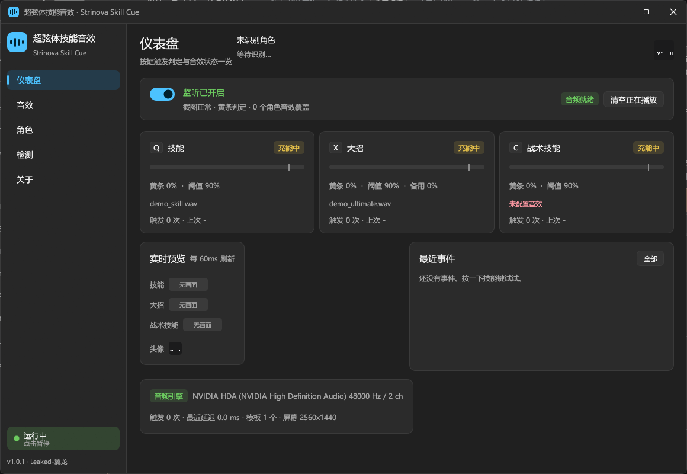
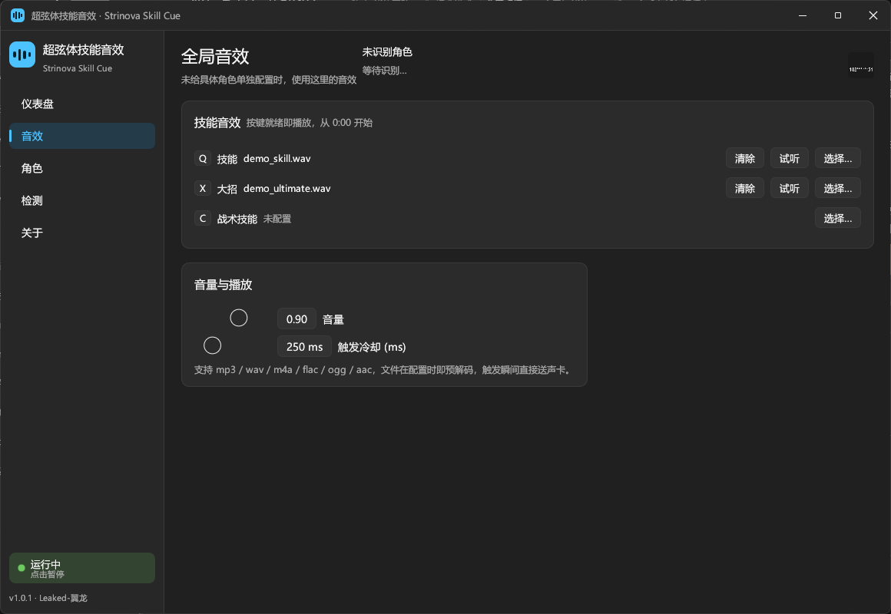
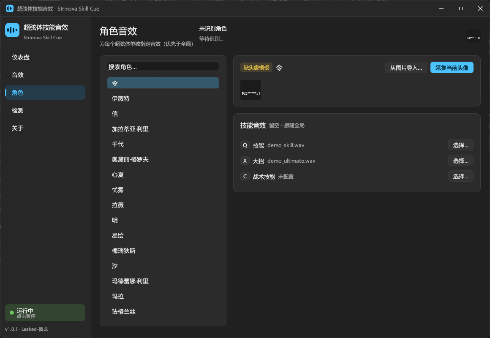
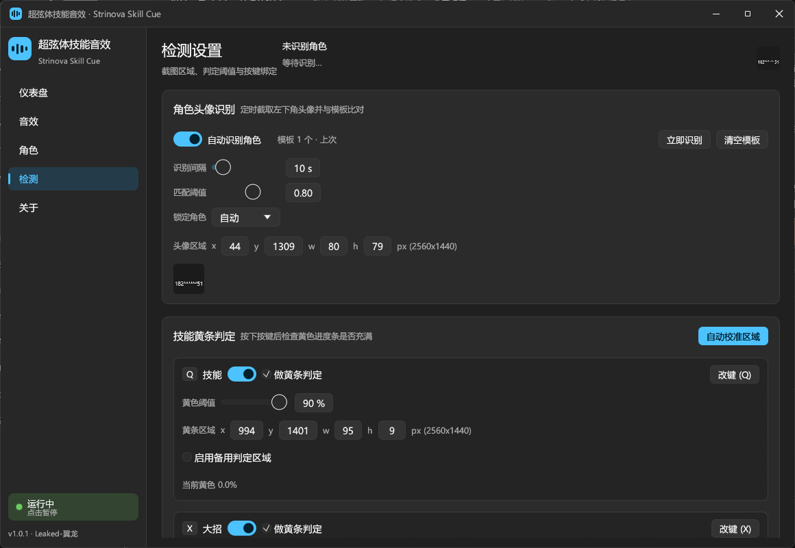
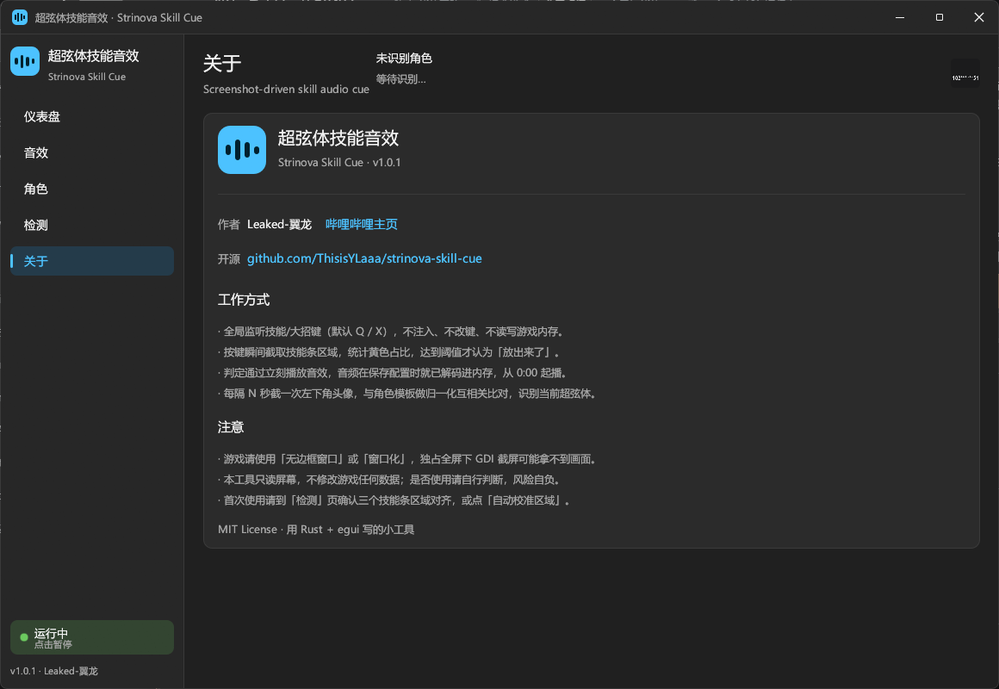

# 超弦体技能音效 · Strinova Skill Cue

> 给《卡拉彼丘》(Strinova) 的技能/大招加上自定义提示音：按键瞬间截屏判定技能条是否充满，**判定通过立刻从 0:00 播放你的音效**。
>
> 作者：**Leaked-翼龙** · [哔哩哔哩主页](https://space.bilibili.com/616045770) · MIT License

纯 Rust 写的 Windows 小工具，release 单文件约 **6 MB**，无运行库依赖（不需要 .NET / WebView2）。只读屏幕、不注入游戏、不读写游戏内存、不联网。



---

## 它解决什么问题

玩超弦体时，"技能到底放出去了没有"只能靠听游戏音效或盯冷却条。这个工具让你：

- 按下 **Q（技能）/ X（大招）/ C（战术技能）** 时，自动判断这次按键**是否真的放出来了**；
- 放出来了 → 立刻播放你自己设置的音效（每个角色可以不一样）；
- 冷却没好、按了没用 → 不响，也不误报。

判定依据是**屏幕下方技能图标下的黄色进度条是否充满**（截屏 + 颜色统计），角色识别依据是**屏幕左下角的角色头像**（截屏 + 归一化互相关）。

---

## 界面

| 音效 | 角色 |
| --- | --- |
|  |  |

| 检测 | 关于 |
| --- | --- |
|  |  |

---

## 功能

| 功能 | 说明 |
| --- | --- |
| 按键触发 | 全局低级键盘钩子（`WH_KEYBOARD_LL`）监听，默认 `Q` 技能 / `X` 大招 / `C` 战术技能，可改键 |
| 黄条判定 | 按下按键 → 截取该技能条区域 → 统计"亮黄"像素占比 → 达到阈值才算放出 |
| 低延迟播放 | 音效在保存配置时就解码成 f32 常驻内存；触发只做一次混音入队，输出流常开，不重新开设备 |
| 多格式音频 | mp3 / wav / m4a / flac / ogg / aac（Symphonia 解码） |
| 全局 + 角色音效 | 先找当前角色的专属音效，没有就用全局音效；角色音效可一键"跟随全局" |
| 角色识别 | 每 N 秒（默认 **10 s**，可调 1~120 s）截一次左下角头像，与模板库做 NCC 比对 |
| 头像模板 | 游戏里显示该角色 → 点「采集当前头像」；也可以「从图片导入」 |
| 实时预览 | 仪表盘/检测页能看到三个技能条和头像的实时截图 + 黄色占比 |
| 自动校准 | 三个技能都攒满时点一次「自动校准区域」，自动定位黄条矩形 |
| Win11 风格 | 自绘标题栏 + 侧边导航 + 卡片 + 圆角开关，跟随系统深浅色 |
| 配置持久化 | `%APPDATA%\StrinovaSkillCue\config.json`，改完自动保存 |

---

## 快速开始

1. **下载**：从 [Releases](../../releases) 下载 `strinova-skill-cue.exe`（或自己编译，见下）。
2. **双击运行**：首次启动会带两个示例音效（`demo_skill.wav` / `demo_ultimate.wav`），按 Q/X 就能听到。
3. **换音效**：`音效` 页 → 选 `技能`/`大招` 行 → `选择…` 挑你自己的 mp3/wav/m4a。
4. **按角色区分**：`角色` 页 → 左边选角色 → 右边给每个技能选音效。
5. **校准（重要）**：进训练场把三个技能都攒满 → `检测` 页 → 点 **自动校准区域**；
   或者手动微调 X/Y/W/H 像素值，用实时预览确认框住了黄条。
6. **建头像模板**：`角色` 页选中角色 → 进游戏显示该角色 → 点 **采集当前头像**。

> 游戏请使用**无边框窗口**或**窗口化**。独占全屏下 GDI 截屏可能拿不到画面（这是 Windows 的限制）。

---

## 判定是怎么做的

### 1. 黄条（技能是否放出）

按下按键后，立刻用 GDI `BitBlt` 截取该技能条的一小块矩形（约 100×13 像素，1~3 ms），像素转 HSV：

```
"亮黄" = 色相 32°~72°  且  饱和度 ≥ 0.30  且  亮度 ≥ 0.40
跨度   = 从左到右被黄色"吃满"的列数 / 区域总列数   （某一列黄色覆盖 ≥50% 才算吃满）
就绪   = 跨度 ≥ 90%
```

> 为什么用「跨度」而不是「面积占比」：大招是 `3/7`、`6/7` 这种分段充能，6/7 时面积已达 86%，用面积会把"没充满"判成"充满了"。跨度只认从左往右连续吃满的部分，旁边的黄色 `3/7` 文字也骗不过它（文字每列覆盖不足 50%）。

默认值是拿 2560×1440 实机截图逐像素量出来的，程序里存成**归一化比例**，换分辨率自动跟随：

| 槽位 | 默认区域（2560×1440） | 默认阈值 | 实测：就绪 / 未就绪 |
| --- | --- | --- | --- |
| 技能 Q | `(994,1401) 95×9` | 90% | 跨度 `100%` / 冷却时按比例 |
| 大招 X | `(1219,1399) 118×13` | 90% | 满条 `100%` / `3/7` 充能 `36%` |
| 大招 X（备用区） | `(1224,1374) 116×22` | 6%（面积） | 就绪时那排亮黄三角 `16.3%` / `0%` |
| 战术 C | `(1466,1399) 101×13` | 90% | 三段全亮 `100%` / `0%` |
| 头像 | `(44,1309) 80×79` | 相似度 0.80 | — |

> 不同角色「大招就绪」的画法不完全一样：有的把充能条直接充满，有的改成一排亮黄三角。所以大招支持**备用判定区域**，两个区域任一达标即算就绪（界面上可以单独开关和调阈值）。

### 2. 角色头像

1. 截取头像框内部（去掉 10% 边框）；
2. 压成 24×24 灰度图，零均值 + L2 归一化；
3. 与所有模板做点积（等价于归一化互相关 NCC），取最高分；
4. 分数 ≥ 阈值才切换角色；低于阈值保留上一次结果，避免打光/残影导致闪断。

### 为什么模板必须"从游戏里采集"

用户最初的设想是「头像 = 官方立绘的裁切版，所以可以直接拿 wiki 立绘当模板」。实测**不成立**：

- 把游戏内头像（80×79）在 24 张官方立绘上做多尺度滑窗 NCC 搜索：最高 **0.725**、第二 **0.692**、均值 **0.641** —— 完全没有判别力（真正的裁切应出现 0.9+ 的尖峰）；
- 直接拿官方 256²/128² 方头像比对：最高 0.547、均值 0.215；用立绘头框裁切：均值 0.037。

结论：游戏内左下角头像是**独立渲染的美术资源**（有独立背景与打光），不是立绘裁切。所以本工具走「进游戏采集一次」的路线，一次点按即成模板，之后自动识别；同时也支持从图片导入模板。

`assets/characters.json` 里仍然收录了 24 个超弦体的**名字、官方立绘链接、头像链接、头部像素框**（抓取自 biligame wiki），用于界面里的角色名册与二次开发。

---

## 自定义音效要求

- 格式：`.mp3` `.wav` `.m4a` `.flac` `.ogg` `.aac`
- 建议**开头就是想要的声音**（不要留静音），因为播放从 0:00 开始
- 时长建议 ≤ 2 s
- 音量在「音效」页可调（0~150%）

---

## 构建

需要 Rust stable（MSVC 工具链）。

```powershell
git clone https://github.com/ThisisYLaaa/strinova-skill-cue.git
cd strinova-skill-cue
cargo build --release
# 产物: target\release\strinova-skill-cue.exe
```

已开启 `lto="fat"` / `panic="abort"` / `strip=true`。

### 离线自检（不开游戏也能验证算法）

```powershell
.\strinova-skill-cue.exe --selftest 截图1.png 截图2.png
```

按当前配置的区域，打印每张截图里三个技能条的黄色占比与判定结果、头像模板匹配前三名，并写入 `自检报告.txt`。
（因为是 GUI 子系统程序，PowerShell 里请用 `Start-Process -Wait` 调用才能看到退出码。）

### 界面截图自检（开发用）

```powershell
.\strinova-skill-cue.exe --snapshot-ui .\shots
```

程序把自己五个页面依次截图存成 PNG 后退出（`README` 里的截图就是这么来的）。

---

## 目录结构

```
src/
  main.rs      入口：GUI / --selftest / --snapshot-ui / 图标 / DPI
  config.rs    配置模型、默认坐标、持久化、示例音效安装
  capture.rs   GDI 截屏（BitBlt + GetDIBits）
  hook.rs      WH_KEYBOARD_LL 全局键盘钩子（只读监听）
  vision.rs    黄条 HSV 判定 + 头像 NCC 匹配
  audio.rs     Symphonia 解码 + cpal 输出 + 混音器
  engine.rs    工作线程：按键→截图→判定→播放；头像定时识别；日志
  theme.rs     Win11 配色 / 中文字体 / 控件
  ui.rs        自绘标题栏 + 五个页面
  snapshot.rs  界面自截图 + 标题栏深浅色 + 窗口定位
  selftest.rs  离线自检
assets/
  characters.json  24 个超弦体名册（名字 + 官方素材链接）
  sounds/          两个示例音效
docs/screenshots/  界面截图
```

---

## 常见问题

**按了键没反应？**
看仪表盘「最近事件」：出现「未就绪 · 黄条 x%」＝判定没通过，去「检测」页确认区域对准黄条或点「自动校准区域」；完全没有事件＝按键没被钩子捕获（检查键位绑定，或是否有别的输入法/宏软件抢占）。

**独占全屏下没画面？** 改成无边框窗口模式。

**识别角色不准？** 用「采集当前头像」给每个角色建模板；或把「匹配阈值」降到 0.72；也可以「锁定角色」直接指定。

**会被反作弊误判吗？** 只调用 Windows 截屏 API 和键盘钩子（都是只读），不注入 DLL、不修改内存、不模拟输入。任何第三方工具的风险请自行判断。

---

## 已知限制

- 仅 Windows。
- 多显示器按主显示器分辨率换算坐标（游戏在主屏时正常）。
- 头像识别是整块图像相似度：同一角色换皮肤只要 HUD 头像不变就能识别；差异很大时请分别采集。

---

## 许可与致谢

MIT License © 2026 **Leaked-翼龙** · [space.bilibili.com/616045770](https://space.bilibili.com/616045770)

感谢 [egui/eframe](https://github.com/emilk/egui)、[cpal](https://github.com/RustAudio/cpal)、[symphonia](https://github.com/pdeljanov/Symphonia)、[rfd](https://github.com/PolyMeilex/rfd)。

《卡拉彼丘 / Strinova》及相关美术资源版权归 心动网络 / Dragonli Studio 所有；本项目与官方无关，仅供学习交流，不含任何游戏美术资源。
